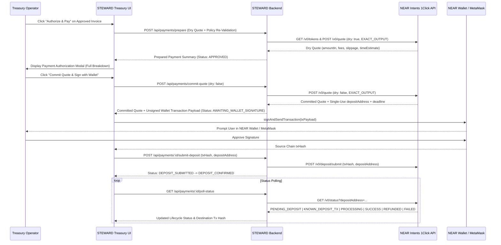

# STEWARD — Non-Custodial Treasury & Multi-Chain Wallet Architecture

## 1. Phase 1 — Existing Architecture Inspection & Implementation Plan

### 1.1 Findings from Existing Codebase Inspection
1. **Payment Execution Service ([`src/pipeline/paymentExecutionService.ts`](file:///home/suxess/Desktop/STEWARD/src/pipeline/paymentExecutionService.ts))**:
   - Currently defines static `ONECLICK_USDC_ASSET_MAP`, `fetchOneClickSupportedTokens()`, `requestOneClickExactOutputQuote()`, `pollOneClickExecutionStatus()`, `independentlyRevalidateBeforeExecution()`, and `executeAuthorizedPayment()`.
   - In `simulation` mode (the default), `executeAuthorizedPayment()` requests a dry quote (`dry: true`) and immediately marks the invoice `PAID` with `custodyMode: 'simulation'` and `txHash: null`.
   - In `live` mode, it previously checked for `OutlayerClient` (`@outlayer/sdk`) custodial agent withdrawal if `OUTLAYER_API_KEY` was configured.
2. **Orchestrator & Approval Service ([`src/pipeline/orchestrator.ts`](file:///home/suxess/Desktop/STEWARD/src/pipeline/orchestrator.ts), [`src/pipeline/approvalService.ts`](file:///home/suxess/Desktop/STEWARD/src/pipeline/approvalService.ts))**:
   - When an invoice passes all 6 security/policy stages with `finalDecision === 'PAY'`, `orchestrator.ts` immediately invokes `executeAuthorizedPayment()`.
   - For real non-custodial wallet execution, an invoice that passes policy (`APPROVED`) must **never** auto-sign a user's wallet silently: real deposits require explicit user confirmation in the Payment Authorization Modal (`AWAITING_WALLET_SIGNATURE`), while preserving deterministic simulation mode for automated test suites and simulated demos.
3. **Database Schema ([`src/server/db.ts`](file:///home/suxess/Desktop/STEWARD/src/server/db.ts))**:
   - Stores `policy_config`, `vendors`, `vendor_address_history`, `blocklist`, `invoices`, `payments`, and `security_events`.
   - Needs non-breaking extensions to persist:
     - `treasury_settings` (preferred funding wallet, preferred source asset, allowed source networks, approved destination assets, approved destination networks, and execution mode `'simulation' | 'non_custodial_live'`).
     - Extended payment lifecycle fields (`lifecycleStatus`, `quoteExpiresAt`, `sourceWalletAddress`, `sourceWalletType`, `originTxHash`, `destinationTxHash`, `refundReason`, `isSimulatedQuote`, `isSimulatedTx`).

---

## 2. Architectural Principles (Non-Custodial Guarantee)

1. **Zero Custody of Private Keys or Seed Phrases**:
   - STEWARD never requests, receives, stores, logs, or transmits private keys or seed phrases on the client or server.
   - All cryptographic signing happens strictly inside the user's connected **NEAR Wallet** (via `@hot-labs/near-connect` isolated sandbox/injected executor) or **MetaMask** (via EIP-1193 `window.ethereum.request`).
2. **Strict Separation of Concerns**:
   - **Operation 1 — Wallet Connection**: Discovering wallets, connecting public account addresses, detecting network/chain ID, and querying on-chain native & token balances.
   - **Operation 2 — Policy & Invoice Approval**: Running the 7-stage deterministic security pipeline (`NEAR AI Cloud TEE` -> `Schema/Math` -> `Vendor Registry` -> `Counterparty Risk` -> `Policy Engine` -> `Controller Approval`).
   - **Operation 3 — Payment Preparation, Wallet Authorization & Settlement Tracking**: Requesting a 1Click `EXACT_OUTPUT` quote, displaying the full Payment Authorization Screen, requesting a committed quote (`dry: false`) only when the user confirms, constructing the exact NEAR (`Transfer` / NEP-141 `ft_transfer`) or EVM (native / ERC-20 `transfer`) transaction, prompting the user's wallet for signature, notifying 1Click (`POST /v0/deposit/submit`), and polling `GET /v0/status` until settlement is confirmed on the destination chain.
3. **Autonomous Unattended Payments vs. Non-Custodial Wallet Signing**:
   - Even when an invoice is under `auto_approve_below_usd` (`$200`) and receives automatic policy approval (`APPROVED` by `AUTO_POLICY_ENGINE`), **every real non-custodial deposit requires explicit human wallet confirmation** because browser wallets require interactive user signature approval.
   - Autonomous unattended execution without interactive popups requires a separate delegated-signing or TEE agent vault architecture (such as OutLayer custody or NEAR function-call access keys with scoped allowances).

---

## 3. Unified Wallet Adapter Design (`src/client/wallets/`)

### 3.1 Common Interface (`TreasuryWalletAdapter`)
Implemented in [`src/client/wallets/types.ts`](file:///home/suxess/Desktop/STEWARD/src/client/wallets/types.ts):
- `connect(options?): Promise<ConnectedWalletSession>`
- `disconnect(): Promise<void>`
- `getAccount(): Promise<string | null>`
- `getNetwork(): Promise<WalletNetworkInfo>`
- `getBalance(address?: string): Promise<WalletPortfolioBalances>`
- `signAndSendTransaction(tx: PreparedWalletTransaction): Promise<WalletTransactionResult>`
- `getTransactionStatus(txHash: string, accountOrChain?: string): Promise<OnChainTxStatus>`
- `subscribeToAccountChanges(cb: (accounts: string[]) => void): () => void`
- `subscribeToNetworkChanges(cb: (network: WalletNetworkInfo) => void): () => void`

### 3.2 NEAR Wallet Adapter (`src/client/wallets/nearWalletAdapter.ts`)
- Built on **`@hot-labs/near-connect`** (`NearConnector` on `network: "mainnet"`).
- Awaits `connector.whenManifestLoaded` before listing discovered wallets (`connector.availableWallets`) or calling `connector.connect()`.
- Inspects `wallet.manifest.features` (`signAndSendTransaction`, `signAndSendTransactions`, `signMessage`, `mainnet`, `testnet`) and reports any unsupported capabilities transparently.
- Queries live NEAR Mainnet native balance (`view_account` via `/api/treasury/near-balances` or direct RPC) subtracting state-storage lock so available spendable NEAR is accurate, and queries NEP-141 fungible token balances (`ft_balance_of` on `USDC`, `USDT`, `wNEAR`) using live token contracts from 1Click `/v0/tokens`.
- Constructs NEP-141 `FunctionCall` transactions (`ft_transfer` with `gas: "30000000000000"` and `deposit: "1"` yoctoNEAR, plus automatic `storage_balance_of` check on the 1Click `depositAddress` and batched `storage_deposit` if needed) or native NEAR `Transfer` actions when funding with native NEAR/wNEAR.

### 3.3 MetaMask Adapter (`src/client/wallets/metaMaskAdapter.ts`)
- Uses standard EIP-1193 provider (`window.ethereum`, preferring `window.ethereum.providers?.find(p => p.isMetaMask)` when multiple extensions are installed).
- Connects via `eth_requestAccounts`, reads chain ID via `eth_chainId` (`0x1` Ethereum Mainnet, `0x2105` Base, `0xa4b1` Arbitrum One), and supports network switching via `wallet_switchEthereumChain` / `wallet_addEthereumChain`.
- Retrieves native ETH balance via `eth_getBalance` and ERC-20 token balances (`USDC`, `USDT`) via `eth_call` (`balanceOf(address)` selector `0x70a08231`).
- Constructs either native value transfers or ABI-encoded ERC-20 `transfer(address,uint256)` (`0xa9059cbb` + 32-byte padded recipient + 32-byte hex uint256 amount) with `eth_estimateGas` verification before invoking `eth_sendTransaction`.
- Subscribes to `accountsChanged`, `chainChanged`, and `disconnect` events on the EIP-1193 provider.

---

## 4. Live 1Click Integration & Payment Lifecycle

